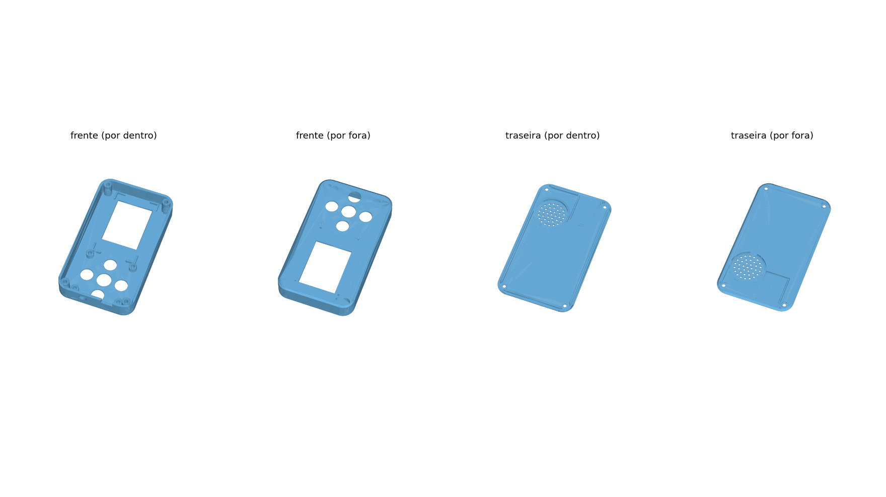

# zPod

MP3 player feito em casa para uma criança de 6 anos, com um pet virtual na tela que reage à música.

- **Cérebro:** ESP32-S3 DevKitC-1 N16R8
- **Tela:** IPS 2.0" ST7789 (240×320)
- **Áudio:** MAX98357A (alto-falante) + PCM5102A (fone P2)
- **Energia:** LiPo 603450 1200 mAh, carga por USB-C (TP4056)
- **Músicas:** microSD interno, envio por Wi-Fi em "modo pais"
- **Carcaça:** impressa em 3D, 66 × 114 × 23 mm

## Estrutura

| Caminho | Conteúdo |
|---------|----------|
| [DECISOES.md](DECISOES.md) | Registro de decisões, lista de compras, mapa de pinos, riscos |
| [carcaca/zpod_case.py](carcaca/zpod_case.py) | Modelo paramétrico da carcaça |
| [carcaca/stl/](carcaca/stl/) | STL prontos para fatiar |



## Regerar a carcaça

```bash
python3 -m venv carcaca/.venv
carcaca/.venv/bin/pip install -r carcaca/requirements.txt
carcaca/.venv/bin/python carcaca/zpod_case.py
```

## Status

Fase de projeto: decisões tomadas, lista de compras fechada, carcaça v0.1 gerada com medidas nominais. Firmware ainda não iniciado.
